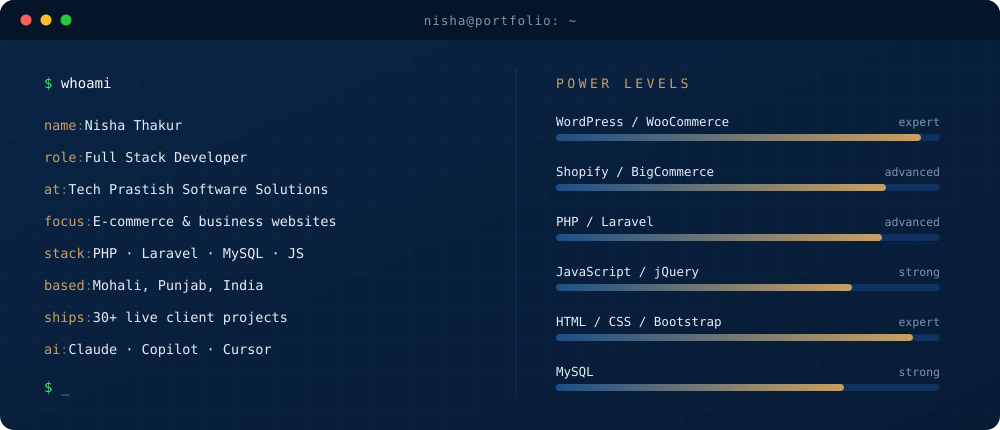

  

  
  
  
  

 

  

 

## &nbsp;⚡&nbsp; What I do

> I build and customise e-commerce stores and business websites that load fast,
> look right on every screen and are easy for clients to run.

- 🛒 &nbsp;**End-to-end store builds** — theme, product pages, checkout and store features
- 🧩 &nbsp;**Custom WordPress** themes, plugins and WooCommerce shops built from scratch
- 📐 &nbsp;**Design-to-code** conversion that stays responsive and cross-browser
- 🔧 &nbsp;**Bug fixing, speed work and maintenance** on live client sites
- 🤖 &nbsp;**AI-assisted delivery** with Claude, Copilot and Cursor for cleaner, faster code

 

## &nbsp;🧰&nbsp; Arsenal

**CMS &amp; E-commerce**

**Backend**

**Frontend**

**Tools &amp; AI**

 

## &nbsp;📊&nbsp; Telemetry

  
  

  

  

 

## &nbsp;📡&nbsp; Uplink

| | |
|:--|:--|
| 🌐 &nbsp;**Portfolio** | [nishathakurwork-dev.github.io](https://nishathakurwork-dev.github.io/) |
| 💼 &nbsp;**LinkedIn** | [nisha-thakur-7815421b0](https://www.linkedin.com/in/nisha-thakur-7815421b0) |
| ✉️ &nbsp;**Email** | [nishathakurwork@gmail.com](mailto:nishathakurwork@gmail.com) |
| 📍 &nbsp;**Based in** | Mohali, Punjab, India |
| 💬 &nbsp;**Open to** | Freelance &amp; full-time e-commerce work |

 

  Built and maintained by Nisha Thakur · <a href="https://nishathakurwork-dev.github.io/">see the full portfolio →</a>

